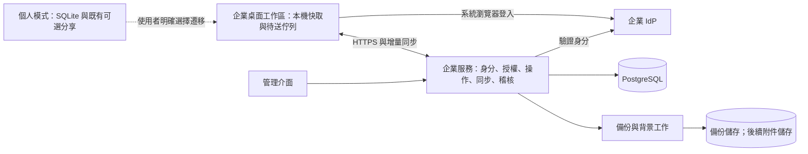

# Cardbe 企業版功能與開發計畫

> 狀態：完整路線圖；本文現況盤點保留 2026-11-04 原始版本基線。企業副本已完成部分基礎原型，最新狀態見[實作進度](enterprise-progress.md)，後續排程見[下一階段計畫](enterprise-next-steps.md)。
>
> 依據：目前 `main` 的 v1.7.0（`812eb5d`）、既有分享／MCP 文件，以及本次 Linux 測試。
>
> 初始假設：優先公司自架／私有部署，目標客群為 20–200 人公司；首輪試點為單一組織、10–30 位使用者。部署方向與人力仍待確認，以下時程不是交付承諾。

## 1. 建議方向

將 Cardbe 發展為「保留離線操作、可由組織管理身分與資料的團隊工作平台」。個人模式繼續不需要帳號；加入企業工作區後，才套用組織登入、權限、同步與資料政策。既有個人資料不會自動上傳。

企業版最值得先補的五項能力：

1. **組織與身分**：公司、工作區、成員、裝置、單一登入及離職停權。
2. **常駐同步服務**：建立看板的人關機後，團隊仍能同步；離線修改有明確的待送與確認狀態。
3. **團隊協作**：任務負責人、留言、提及、收件匣與交接。
4. **管理與追蹤**：服務端授權、持久稽核、分享／匯出／外掛／MCP 政策。
5. **可維運的交付**：備份還原、升級、監控、簽章及明確的平台支援範圍。

先重用現有看板、搜尋、日曆、Gantt、Flow、每日計畫、依賴、重複任務和外掛能力。第一版不納入完整網頁工作台、手機 App、SaaS 計費、多區高可用或全面自訂工作流程。

## 2. 現況與缺口

| 面向         | 已有能力                                                       | 企業版需要補的部分                                             |
| ------------ | -------------------------------------------------------------- | -------------------------------------------------------------- |
| 個人工作管理 | 多看板、優先級、清單、相依阻擋、重複任務、提醒、搜尋與多種視圖 | 成員指派、留言、提及、團隊收件匣；後續再做自訂欄位與審批       |
| 分享與角色   | Owner／Editor／Viewer、Iroh 邀請、裝置核准與撤銷、Loro 合併    | 真實使用者與組織成員模型、工作區授權、持續在線的組織同步端     |
| 離線資料     | 本機 SQLite，個人核心功能不依賴服務                            | 企業資料的本機快取隔離、待送操作、授權到期與重新連線處理       |
| 活動紀錄     | 任務生命週期事件與統計                                         | 具名操作者、服務端時間、權限變更與失敗事件、獨立保留的企業稽核 |
| MCP          | 本機 Bearer token、每個 client 的看板授權與唯讀／可寫限制      | 組織政策、使用者歸屬、持久去重與稽核；維持本機服務邊界         |
| 外掛         | Wasmtime 沙箱、看板與網路授權、秘密值保管                      | 組織核准套件、固定版本／雜湊、來源驗證與集中停用               |
| 備份         | 手動單板／全量 JSON、匯入前快照                                | 完整範圍清單、自動備份、保留版本、復原預覽、實際還原演練       |
| 平台         | Windows 為主要驗證平台；Linux 已完成有限實測                   | Linux 正式乾淨建置、套件發佈與真實桌面驗證；企業更新流程       |

現有共享以擁有者裝置為中心，擁有者離線時，編輯者不能直接交換更新。邀請是 bearer capability，現有板級角色不能直接當作組織身分。詳見[分享與隱私](sharing-and-privacy.md)及[資料模型](../src-tauri/src/models.rs)。

現有 `task_events` 用於生命週期與統計，刪除看板會連帶刪除相關事件；MCP activity 只保留最近 200 次呼叫於記憶體，creation idempotency 也不跨重啟保存。這些可保留原用途，企業稽核與持久去重需要另建。詳見[任務事件](../src-tauri/src/task_events.rs)、[MCP 文件](mcp-server.md)與[去重實作](../src-tauri/src/operations/idempotency.rs)。

## 3. 功能優先級

### P0：進入企業試點前必須具備

| 功能             | 第一版範圍                                                                  | 驗收重點                                     |
| ---------------- | --------------------------------------------------------------------------- | -------------------------------------------- |
| 組織與工作區     | 一個部署先服務一家公司，資料模型預留組織範圍；明確區分個人／企業資料        | 加入公司不會上傳既有個人看板                 |
| OIDC 單一登入    | 對接一個實際試點 IdP；MFA 由 IdP 執行；裝置註冊與 session 撤銷              | 停權後的新請求及後續同步被拒絕               |
| 成員管理         | 加入、啟用、停權、離職交接；防止移除最後一位組織擁有者                      | 任務及看板不因人員離職失去管理者             |
| 工作區與看板權限 | 組織管理角色與內容存取角色分離；服務端逐次驗證                              | Viewer 不能寫入；跨工作區資源不可存取        |
| 受管理同步       | 常駐服務、持久待送佇列、重試去重、重連、衝突與拒絕提示                      | 擁有者關機不影響其他成員；重送不重複建立資料 |
| 指派與討論       | 每張任務先有一位主要負責人；留言、提及、已讀／未讀收件匣                    | 指派與提及對象必須有該看板的存取權           |
| 管理介面         | 成員／裝置、看板存取、最後同步、政策、稽核與備份狀態                        | 非開發人員能完成核心管理流程                 |
| 資料與整合政策   | 控制對外分享、匯出、插件、MCP、連結預覽；企業板預設關閉公開分享與未核准整合 | 所有資料入口／出口套用一致政策               |
| 持久稽核         | 成員與權限異動、重要資料修改、整合操作、匯出、授權失敗                      | 有可辨識的 actor、來源、結果與服務端時間     |
| 資料復原         | 排程備份、版本保留、軟刪除／垃圾桶、還原工具及文件                          | 在全新隔離環境還原並核對內容與關聯           |
| 部署與更新       | 單一私有部署方案、TLS、健康檢查、版本相容、簽章與回復程序                   | 服務重啟、升級失敗與舊版客戶端都有可預期行為 |

OIDC 原生桌面登入採系統瀏覽器、Authorization Code 與 PKCE；不把可保密的 client secret 放進桌面程式。身分綁定使用 `(issuer, subject)`，email 只作顯示或聯絡資料。參考 [OIDC Core](https://openid.net/specs/openid-connect-core-1_0.html)及 [RFC 8252](https://www.rfc-editor.org/rfc/rfc8252)。

Cardbe 管理員停權須在下一次服務端存取生效；僅在外部 IdP 停權的偵測延遲，另依其登出通知、重新驗證或佈建整合決定。選定 IdP 時要訂出 session 期限與停權傳遞方式，不能把「能用 OIDC 登入」當作已完成即時離職停權。

### P1：試點確認需求後擴充

- **身分治理**：SCIM 自動佈建／停權、群組映射、外部訪客與權限到期；SAML 視客戶 IdP 需求評估。
- **協作深化**：附件、任務多位協作者、自訂欄位、審批、工作流程規則與自動化。
- **跨團隊管理**：專案彙總、團隊負載、跨板報表；重用既有統計與視圖。
- **整合**：公開企業 API、webhook、GitHub／GitLab／Teams／Slack；由客戶需求排序，不同時開發全部。
- **資料治理**：稽核匯出至 SIEM、可設定的保留與清除策略、細粒度還原、組織外掛目錄。
- **遷移工具**：CSV 匯入／匯出與欄位對應、ICS 日曆整合，優先支援試點原本使用的工具。

SCIM 可依 [RFC 7644](https://www.rfc-editor.org/rfc/rfc7644)及其後續更新規劃；它是成員佈建機制，不能替代每次請求的內容授權。

### P2：產品與營運模式確定後再投資

- SaaS 多租戶營運、訂閱與帳務、用量限制、資料區域選擇。
- 高可用、多區容災、大型組織委派管理、Kubernetes 部署。
- 完整瀏覽器工作台、手機 App、進階企業搜尋。
- 特定法規或產業專案、法律保留、客戶自管金鑰；需求與驗證範圍另立計畫。
- 完整端對端加密工作區：先釐清搜尋、稽核、金鑰復原及管理權限的取捨。

## 4. 角色與管理邊界

| 範圍         | 建議角色 | 權責                                                         |
| ------------ | -------- | ------------------------------------------------------------ |
| 組織         | Owner    | 管理組織、IdP、管理員與重大政策；必須有所有權交接流程        |
| 組織         | Admin    | 管理成員、裝置、政策、備份與服務狀態；不自動取得所有看板內容 |
| 組織         | Member   | 加入被授權的工作區與看板                                     |
| 工作區／看板 | Manager  | 管理成員存取與看板設定，範圍受組織政策約束                   |
| 看板         | Editor   | 讀取、編輯及討論；匯出／整合另受政策限制                     |
| 看板         | Viewer   | 唯讀；留言是否開放由後續需求決定，首版先不開放               |

組織管理員若需要緊急讀取受限內容，應使用獨立的緊急存取流程，記錄理由、授權範圍與稽核；不能以管理員角色默默繞過內容權限。私有部署的主機／資料庫管理者仍屬基礎設施信任邊界，產品角色無法阻止其直接讀取可解密的伺服器資料。

服務端預設拒絕，從已驗證的 session 建立 actor，逐次檢查組織、工作區、看板與動作。URL 或 payload 中的 `org_id`、`actor_id` 不是授權證明。原則參考 [OWASP Authorization Cheat Sheet](https://cheatsheetseries.owasp.org/cheatsheets/Authorization_Cheat_Sheet.html)。

## 5. 建議架構

### 5.1 個人模式與受管理工作區並存

先採**模組化單體服務**：以 Rust 服務承接認證、授權、操作與同步，PostgreSQL 保存組織資料、已接受狀態、操作結果與稽核。背景工作先與服務共用程式庫；備份放在獨立儲存位置，新增附件時再加入物件儲存的檔案流程。管理介面沿用 Svelte 元件與設計風格。

目前 operation layer 綁定 Tauri／`SharedAppData`，無法直接當成無介面的服務使用。應抽出不依賴桌面的驗證與業務規則，再建立桌面儲存及服務端儲存 adapter。可評估 Axum；新增依賴與 crate 邊界在實作前確認，不在此文件變更依賴。

第一版不要求 Redis、獨立搜尋叢集、訊息佇列或微服務。個人搜尋維持現有 SQLite 實作；企業跨板搜尋須先限制授權範圍再檢索，初期可由 PostgreSQL 承接服務端需求。

### 5.2 受管理同步的信任邊界

企業工作區採「**服務端已確認狀態＋本機待送操作**」。已有 Loro 資料結構與同步經驗可以重用，但企業操作接納規則需要新增：

1. 桌面先保存待送操作，包含穩定的 operation UUID、資源 ID、裝置、基礎版本與型別明確的變更。介面標示「待同步」，尚未視為服務端已接受。
2. 服務端依目前 session 取得 actor，重新驗證 membership、角色、政策、資料格式與版本前提。不能直接信任客戶端宣稱的操作者或操作時間。
3. 在同一持久化交易提交業務變更、operation 結果、稽核及待發送通知事件；成功回覆前必須確保提交完成。
4. 用穩定 operation ID 去重，服務重啟後仍有效；同 ID 不同內容應拒絕。去重保留期限至少覆蓋允許的離線／重試期間，過舊操作要求重新對帳。
5. 以游標與快照支援斷線續傳、分頁、批次與背壓；其他成員取得更新後，再由桌面更新本機投影。

**不要直接接受任意 peer Loro blob，再把其中的資料當作已通過企業授權。** 首版先接受可驗證的 typed operations，由服務端產生受承認的更新；Loro 是否繼續作為內部狀態表示、長文字如何合併，應在同步原型階段驗證後記錄架構決策。

本機待送操作與服務端已接受文件分開保存，以本機疊加狀態提供預覽；被拒絕的操作不得混入已接受文件，成為後續 CRDT 更新的因果依賴。拒絕後從已接受狀態重建預覽，不能用舊整板快照覆蓋其他人的更新。成員、角色、政策與 session 等管理資料也不放進客戶端可編輯的 Loro 文件。

首版衝突規則也要明確：不同欄位可合併；同欄位或刪除／編輯衝突回傳可處理的結果，不以客戶端時鐘偷偷覆蓋。Undo 轉為具版本前提的反向操作，不得還原整板快照而覆蓋其他人的後續編輯。

受管理看板只能經企業服務同步，不同時開啟原有個人 P2P 寫入路徑。新的企業協定有自己的版本與能力協商；舊客戶端不能以既有邀請方式加入企業板。

### 5.3 離線與撤權

- 已授權成員可離線編輯允許快取的資料；成員／權限管理、服務端匯出及其他高權限操作必須在線。
- 重新連線時依**當下權限**驗證所有待送操作；已被停權或移除板級權限的使用者，其未接受的寫入必須拒絕，不能因聲稱在撤權前建立就接受。
- 撤權與寫入提交須有明確交易排序，例如鎖定授權版本或以版本條件提交；不能只在進入 API 時檢查一次，也不能只等待 JWT 到期。撤權同時使既有訂閱失效，後續推送與讀取重新驗證。
- 被拒絕內容以可辨識的受限草稿處理；恢復、複製或匯出遵守組織政策，不自動搬到個人工作區。
- 可提出例如 72 小時的離線使用期限作為產品政策，但時間長度須由試點決定；本機期限與快取鎖定屬正常客戶端控制，不能抵抗使用者修改程式、時鐘或複製資料。
- 撤權能阻止後續服務端存取，**不能保證離線裝置立即失去已下載內容，也不能遠端抹除既有副本**。高敏感工作區可採在線模式與最小快取，搭配客戶裝置管理措施。
- 介面至少區分：已同步、待同步、需重新登入、衝突待處理、權限已撤銷；離線期間的失敗不可默默丟棄。

### 5.4 資料隔離與加密選擇

第一版先單一組織部署，所有企業資料仍帶明確組織範圍；外鍵、唯一鍵、查詢及檔案索引必須保留範圍。桌面不同組織快取與個人資料要有可驗證的隔離，跨來源複製必須經政策檢查。SaaS 上線前另做多租戶隔離測試，不把「表上有 org_id」視為完成。

模型明確標記 Local／Peer／Managed 來源，缺失或未知的企業授權資訊一律拒絕，不沿用舊資料預設 Owner 的相容行為。登出、停權或快取鎖定後，正常客戶端的全域搜尋、通知預覽、匯出與個人備份都不能繼續帶出該企業內容。首版以整板作為內容授權範圍，不承諾已複寫到裝置的隱藏欄位能保持機密。

快取、索引、待送草稿與通知還須綁定 principal；同公司使用者 A 登出、B 登入同一台電腦時，B 不得讀到 A 的受限內容，也不能替 A 送出待送操作。帳號切換的鎖定／清除流程與重新授權應納入驗收。

建議首版明確採**服務端可讀取企業工作區內容**的模式，支援集中授權、搜尋、備份與管理。傳輸用 TLS，伺服器磁碟／備份加密並分離金鑰；桌面憑證使用系統秘密儲存，本機資料先定義 OS 磁碟加密要求及快取清除流程。若需應用層資料庫加密，另評估其實作與復原成本，不宣稱現有 SQLite 已加密。

完整端對端加密會改變管理員復原、全文搜尋與稽核內容的可見性，應作獨立產品決策，不能與上述模式混稱。

## 6. 資料模型與程式工作分解

### 6.1 建議新增的模型

| 模型                              | 核心資料與用途                                                                                  |
| --------------------------------- | ----------------------------------------------------------------------------------------------- |
| Organization／Workspace           | 組織、工作區、政策版本、狀態                                                                    |
| Principal／IdentityBinding        | 產品內穩定 user ID、IdP issuer／subject；email 可變更                                           |
| Membership／BoardAccess           | 成員狀態、組織角色、工作區與板級授權；群組後續加入                                              |
| Device／Session                   | 使用者裝置、最後活動、撤銷狀態、憑證生命週期                                                    |
| ResourceIdentity                  | 全域穩定的字串 ID 與既有本機數字 ID 映射，涵蓋看板／任務／欄位與關聯                            |
| TaskAssignee／Comment             | 負責人、作者、文字、版本、刪除狀態；引用對象受組織與看板限制                                    |
| Notification／Delivery            | 收件人、事件、已讀狀態、去重鍵；先做 App 收件匣，郵件後續加入                                   |
| PendingOperation／OperationResult | 本機待送內容、服務端接受／拒絕結果、持久去重、基礎版本                                          |
| SyncCheckpoint／Snapshot          | 同步游標、快照、協定與 schema 版本、復原 epoch                                                  |
| AuditEvent                        | org、actor、device、client、來源、動作、資源、服務端時間、結果、request／operation ID、政策版本 |
| BackupManifest／BackupJob         | 備份範圍、版本、雜湊、保留時間、執行與驗證結果                                                  |
| DeletedResource                   | 軟刪除時間、刪除者、可復原期限與後續清除狀態                                                    |

既有 ID 與匯入格式繼續可讀；新增 canonical ID 時使用對照與版本化遷移，不一次重編所有個人資料。現在的本機 schema 版本、企業服務 schema、同步協定及公開 plugin API 各自演進。

### 6.2 可重用與需要抽離的程式

| 工作流         | 既有切入點                                                                                                                                                             | 規劃改動                                                                                             |
| -------------- | ---------------------------------------------------------------------------------------------------------------------------------------------------------------------- | ---------------------------------------------------------------------------------------------------- |
| 領域規則與授權 | [operations](../src-tauri/src/operations/mod.rs)、[board mutations](../src-tauri/src/board_mutations.rs)                                                               | 抽出不依賴 Tauri 的規則；建立服務端 actor／policy context；盤點 UI、MCP、plugin 與同步的所有提交入口 |
| 儲存與資料模型 | [storage](../src-tauri/src/storage.rs)、[models](../src-tauri/src/models.rs)                                                                                           | 新增企業範圍、本機 ID 對照、待送佇列與遷移；服務端另建 PostgreSQL adapter                            |
| 同步           | [Loro board](../src-tauri/src/loro_board.rs)、[Iroh host](../src-tauri/src/commands/iroh_share/host.rs)、[Iroh client](../src-tauri/src/commands/iroh_share/client.rs) | 保留個人分享；抽出可重用資料轉換，新增企業協定與服務端操作接納流程                                   |
| 稽核與整合     | [task events](../src-tauri/src/task_events.rs)、[MCP server](../src-tauri/src/mcp/server.rs)、[plugin manager](../src-tauri/src/plugins/manager.rs)                    | 任務統計維持原用途；新增持久稽核並保留具名 actor 與整合來源                                          |
| 備份與復原     | [import/export](../src-tauri/src/commands/import_export.rs)、[storage](../src-tauri/src/storage.rs)                                                                    | 單板 Flow 完整性、備份清單、版本保留、復原預覽與一致性驗證                                           |
| 團隊介面       | [routes](../src/routes)、[共用元件](../src/lib/components/ui)                                                                                                          | 工作區切換、登入、成員選擇、指派、留言、收件匣、同步狀態與管理頁面；維持中英雙語                     |
| 平台交付       | [CI](../.github/workflows/main.yml)、[release](../.github/workflows/release.yml)、[resource usage](../src-tauri/src/resource_usage.rs)                                 | Linux 建置與統計修正、平台能力矩陣、簽章、版本相容及更新渠道                                         |

新增服務與共用 domain crate 的目錄位置在階段 0 決定；上表是工作切入點，不表示現有模組已可直接部署成服務。

## 7. 稽核、外掛與 MCP 政策

### 稽核

稽核由服務端產生；資料修改及成功的權限／政策管理操作，都與其結果在同一交易保存。拒絕的請求另有可持久化的紀錄流程，並限制重複惡意請求造成的儲存負擔。內容包含 actor、來源、動作、資源、結果及關聯 ID；變更摘要避免記錄 token、秘密值或不必要的敏感全文。

離線客戶端提出的建立時間只能記為「客戶端聲稱時間」；服務端能確定的是接收與接受時間。一般使用者與應用角色不可任意修改稽核，刪除看板不連帶刪除尚在保留期內的紀錄。首版可用 90 天作為待確認的試點預設，提供容量估算與匯出；正式保留規則由客戶需求決定。

雜湊鏈可協助檢查完整性，但無法單獨保證主機管理者不能重寫紀錄。若需要更強證據，另加獨立儲存、受保護保留或外部稽核接收端；不僅憑此功能宣稱取得合規認證。

### 外掛與 MCP

企業資料的有效權限為「使用者目前權限 ∩ 組織政策 ∩ 整合個別授權」。至少涵蓋：

- 外掛核准版本／雜湊、網路目的地、可讀寫看板；停用與更新權限重新審核。既有 Wasm 沙箱繼續保留。
- 本機 MCP 保持預設關閉、僅 loopback、token 與板級授權；**不把既有 MCP listener 直接公開到網際網路**。未來企業 API 使用獨立認證與速率限制。
- 原有「所有看板」授權不自動延伸到新加入的企業工作區；需要明確的組織範圍與政策判定。
- UI、plugin、MCP 和同步對企業板的修改都進入待送／服務端接受流程；不能繞過服務端，直接把本機寫入當作企業已提交狀態。
- 稽核保留觸發使用者及 plugin instance／MCP client；日後服務端排程使用有範圍的服務帳號，不借用個人永久 token。
- 若修改公開 WIT，應在 `plugin-api` 原始專案變更並更新受審查的 submodule 版本，不能修改本專案的複製契約。

本機政策只約束正常客戶端；使用者能讀取的離線內容仍可能被複製。匯出／整合限制不得宣稱為能防止所有資料外流的保證。

## 8. 備份、遷移與 Linux 交付

### 8.1 區分資料匯出與災難復原

建立明確的備份範圍表：看板、任務、Flow、筆記、Focus、每日計畫、留言、權限、稽核、外掛設定與未來附件，各自標示是否包含及如何恢復。現有 JSON 全量匯出不等於整個應用環境的災難復原備份；部分設定、身分與 secrets 刻意排除，不能直接全部塞進可攜 JSON。

企業備份應包括資料庫一致性快照、必要檔案與 manifest；加密金鑰另有保管與恢復流程。還原工具核對版本、內容雜湊、參照與結果，先演練磁碟滿、損壞檔案與中途失敗。第一版先每日備份及故障前手動快照，候選目標為 **RPO ≤ 24 小時、RTO ≤ 4 小時**，須以指定規模演練後才承諾；更短 RPO 再加入持續備份／時間點復原。

復原不應直接使舊 session、邀請或已撤銷的帳號重新生效。應有 fail-closed 恢復模式、更新復原 epoch、撤銷既有 session、重新核對 IdP 成員與現行存取政策後才開放同步。軟刪除、備份保留、稽核保留與最終清除分別定義；Loro 歷史中的刪除不代表立即安全抹除。

### 8.2 個人／P2P 看板轉為企業工作區

1. 使用者明確選擇看板，顯示即將交由組織管理的內容與政策。收到的 P2P 看板須取得來源擁有者的遷移授權；持有 Viewer／Editor 存取權不自動代表可將資料交給另一組織。
2. 匯入前驗證資料與 ID 對照，包括欄位、任務相依、封存及 Flow 參照；提供數量與內容摘要。
3. 以目前可見內容建立企業基線及新的授權，不預設搬運完整 Loro 歷史，避免帶入已刪除內容；不搬移裝置秘密、舊邀請或本機 MCP token。原本的活動只能標記為匯入來源，不能偽造成具名企業稽核。
4. 切換時先停止原 P2P 寫入並完成對帳，再啟用企業同步；不得兩邊同時當作可寫主來源。
5. 保留遷移報告與可復原的原始備份；來源資料是否保留由使用者及組織政策明確決定。

### 8.3 Linux 與跨平台基礎整理

2026-11-04 的本機測試已完成前端 723 項通過、1 項略過，以及 Linux WebKit GUI 中文看板／欄位／任務建立與重啟後持久化。這是在隔離測試環境中完成，原始鎖定依賴的 Linux 建置仍有問題：

| 項目           | 已知狀態                                                                                                          | 正式交付前處理                                                                                                                                        |
| -------------- | ----------------------------------------------------------------------------------------------------------------- | ----------------------------------------------------------------------------------------------------------------------------------------------------- |
| deep-link 建置 | `tauri-plugin-deep-link 2.6.2` 搭配 `rust-ini 0.21.3` 缺少 `ParseOption` 初始化欄位；本次只修補測試快取以完成驗證 | 透過正式依賴更新處理並在乾淨 cache 重建；上游 [2.6.3 發佈](https://github.com/tauri-apps/plugins-workspace/releases/tag/deep-link-v2.6.3)已含相關修正 |
| 資源統計       | Linux thread 被納入子行程，記憶體／CPU 重複計算                                                                   | 評估在兩處 refresh 加入 `.without_tasks()`，加入真實 Linux thread 的回歸驗證                                                                          |
| 桌面整合       | 尚未驗證實體桌面的完整行為                                                                                        | GNOME X11／Wayland：通知、托盤、快捷鍵、deep link、輸入法、檔案對話框及字型輸出                                                                       |
| 發佈           | 現有流程以 Windows 為主                                                                                           | 優先 Ubuntu `.deb` beta；AppImage／其他發行版依需求後續驗證                                                                                           |

階段 0 應完成兩個 Linux 已知問題與備份缺口盤點；垃圾桶、排程備份及完整桌面支援在後續對應階段完成。Xvfb 成功不等於 Wayland 或所有 Linux 發行版已支援。

企業發佈需定義穩定／測試渠道、更新簽章、版本相容及最低可連線版本。初期目標可設定服務端支援當期與前一期客戶端，具體窗口依測試決定；資料庫遷移失敗以備份復原處理，不能假設舊程式能直接讀取已升級的資料庫。

## 9. 開發階段與時間估算

以下以 **2 位全職工程師，加上兼任產品／設計／QA 與安全審查支援**估算；每階段通過退出條件才推進。需要企業身分與分散式同步經驗，不能以新增頁面數量估工。

| 階段              | 預估時間 | 主要交付                                                                            | 退出條件                                                     |
| ----------------- | -------- | ----------------------------------------------------------------------------------- | ------------------------------------------------------------ |
| 0：需求與基礎整理 | 2 週     | 訪談 3 個目標團隊、選定試點 IdP／平台、Linux 修正、備份範圍、架構決策與同步風險原型 | 有一個可重現的試點情境、測試資料及明確 MVP；原始碼可乾淨建置 |
| 1：身分與服務基礎 | 4–6 週   | 抽離 domain、企業服務、OIDC、組織／工作區、權限、裝置與稽核基礎                     | 跨組織／跨板負向測試通過；停權與 session 撤銷可驗證          |
| 2：受管理同步     | 6–8 週   | 持久待送佇列、服務端操作接納、去重、重連、衝突、版本協商                            | 擁有者離線仍可協作；重送不重複；撤權後待送寫入被拒絕         |
| 3：團隊工作流程   | 3–4 週   | 指派、留言、提及、收件匣、管理介面、整合政策、垃圾桶                                | 非開發人員能完成建組織、授權、協作、停權與交接               |
| 4：維運與資料保護 | 4–6 週   | 排程備份／還原、升級、簽章、監控、Linux 桌面驗證、支援手冊                          | 完成還原、升級失敗、服務重啟及舊版客戶端演練                 |
| 5：實際試點       | 3–4 週   | 10–30 人試用、修復主要問題、確認部署與支援流程                                      | 無未解決的高嚴重度授權／資料遺失問題，試點團隊願意持續使用   |

P0 完成約需 **19–26 週**，加上實際試點合計 **22–30 週**；再納入整合、客戶回饋與風險緩衝，完整私有部署試點建議抓 **6–9 個月**。階段 2 結束後重新估算；若只有一位兼職開發者，應縮小到一個 IdP、一個桌面主平台及最小協作流程，再依實際投入排期。SaaS、SCIM、附件治理與多區部署不包含在此估算。

建議分工：工程師 A 負責桌面、domain、離線佇列及同步介面；工程師 B 負責服務、身分、授權、稽核及部署。同步協定與遷移由兩人共同審查，QA 持續建立隔離測試情境，不留到最後才補。

## 10. 驗收與規模測試

### 必須能走完的五條流程

1. 管理員部署服務、連接 IdP、建立工作區、加入試點成員。
2. 主管建立看板、設定讀寫權限、指派任務；成員收到提及並完成討論。
3. 兩台桌面斷網修改後重連，看到接受、衝突或拒絕結果；Undo 不覆蓋別人的變更。
4. 管理員停用成員／裝置並交接任務；既有連線與排隊寫入不能繼續取得未授權存取。
5. 管理員在隔離環境還原備份，核對內容、關聯與稽核，重新確認授權後恢復服務。

### 技術品質門檻

| 類別       | 必測情境                                                                                                                                           |
| ---------- | -------------------------------------------------------------------------------------------------------------------------------------------------- |
| 授權與隔離 | 跨組織／工作區／看板 ID、UI／MCP／plugin／同步入口、搜尋結果、通知內容、匯出、未來附件與 WebSocket 訂閱；錯誤不得洩漏其他組織資料                  |
| 同步正確性 | 重複／亂序／遺失回覆、服務與桌面重啟、不同欄位／同欄位衝突、刪除與編輯競爭、驗權後提交前撤權、撤權後重連、拒絕後本機預覽重建、游標失效與完整重同步 |
| 稽核與去重 | 人員／MCP／plugin actor 可區分，成功與拒絕可追查；同一 operation 重送不重複產生業務結果                                                            |
| 備份與遷移 | 舊格式、缺檔、壞檔、磁碟滿、中途中斷、ID 衝突、Flow／相依關聯、復原後不重新啟用舊權限                                                              |
| 整合政策   | 外掛更新／撤銷、MCP all-boards、離線政策到期、對外分享與匯出；禁止的路徑沒有先傳資料再報錯                                                         |
| 平台與發佈 | Windows 回歸、Linux 真實桌面、安裝／升級／移除保留資料、簽章、客戶端版本不相容提示                                                                 |
| 程式品質   | 依專案規範執行 frontend／Rust 測試、Svelte check、clippy 與實際打包；本機先前略過的 Chromium XSS 測試須補驗                                        |

所有測試使用合成或經核准的去識別資料，不複製使用者正式資料庫。

### 規模與效能以量測決定

候選試點資料集：**25 位成員、5 位同時編輯、20 個看板、10,000 張有效任務**，另加 50,000 張封存任務、長描述、中文與 emoji。這是要驗證的負載，並非現有產品容量保證。

在固定硬體與網路條件記錄冷啟動、本機操作、搜尋、服務端接納、其他客戶端收到更新的 p50／p95、峰值 RSS、資料庫大小及備份時間。可先以本機常見操作 p95 ≤ 200 ms、搜尋 p95 ≤ 1 s、同區在線同步 p95 ≤ 2 s 作為調校目標；實測後再設定對外指標。

目前限制包含 board-write payload 8 MiB、Iroh message 16 MiB、host 同時連線 16 條，以及搜尋預設候選／結果各 1,000 筆。這些不能換算成「支援 16 人」或「已支援百人」。企業協定需驗證增量、分頁、限額與背壓；搜尋的截斷行為也要讓使用者能理解，不能只提高上限。

## 11. 首兩週可直接開工的清單

| ID      | 工作                 | 完成定義                                                                                   |
| ------- | -------------------- | ------------------------------------------------------------------------------------------ |
| ENT-001 | 訪談與試點範圍       | 確認部署、IdP、平台、活躍人數、資料量與前三個工作流程，記錄不做項目                        |
| ENT-002 | 架構決策紀錄         | 寫出個人／企業邊界、服務端信任模型、離線與加密政策、資料所有權                             |
| ENT-003 | 企業同步技術原型     | 用隔離資料證明 typed operation → 授權 → 持久結果 → 重試去重；包含撤權反例，尚不追求完整 UI |
| ENT-004 | Linux 乾淨建置修正   | 以正式依賴流程處理 deep-link，相容性修正不依賴本機快取；保留 Windows 驗證                  |
| ENT-005 | Linux 資源統計修正   | 排除 thread 重複計算，真實 thread 情境與 GUI 量測一致                                      |
| ENT-006 | 備份範圍與 Flow 缺口 | 列出可攜匯出／災難復原差異，補單板 Flow 的匯出匯入驗證                                     |
| ENT-007 | 授權入口盤點         | 列出 UI、MCP、plugin、sync、LAN 分享、搜尋／匯出的實際讀寫路徑與共同檢查點                 |
| ENT-008 | 基準資料與測試計畫   | 產生上述合成資料集，記錄硬體與現況指標，建立階段驗收清單                                   |

這兩週的目的，是消除同步與授權設計的主要不確定性，再決定完整企業服務實作；不是在兩週內交付企業版。

## 12. 商業範圍與待確認決策

企業價值可集中在 SSO／組織管理、集中政策、稽核、管理型同步、部署與支援。個人離線核心及資料可攜性繼續保留；資料修復與基本備份不應變成必須購買企業方案才能補救的缺口。是否另設團隊方案、價格與支援時段，應等試點訪談與成本量測後決定。

正式提供商業方案前，需要確認專案及依賴授權、發佈模式、維護責任與安全更新流程。SLA、合規與可用性承諾必須有實際運作及驗證證據。

| 待確認事項   | 本草案先採用的假設                  | 會影響的決策                     |
| ------------ | ----------------------------------- | -------------------------------- |
| 部署方式     | 公司自架／私有部署優先              | 安裝、營運責任、多租戶與計費範圍 |
| 首批客戶     | 20–200 人公司中的 10–30 人團隊      | 權限深度、容量測試及工作流程     |
| 身分提供者   | 先整合一個 OIDC IdP                 | 登入、登出、停權偵測與日後 SCIM  |
| 主要桌面平台 | Windows 持續支援，Ubuntu Linux beta | 打包、桌面整合、支援矩陣與時程   |
| 離線需求     | 允許受管理的離線編輯，期限待定      | 快取、待送、撤權體驗及資料風險   |
| 資料可見性   | 企業服務可讀取工作區內容            | 搜尋、備份、稽核及加密架構       |
| 首版協作範圍 | 單一負責人、留言、提及與收件匣      | 附件、審批及自訂欄位是否提前     |
| 人力與期限   | 2 位全職工程師及兼任支援            | 6–9 個月估算是否適用             |

**下一個里程碑：完成 ENT-001～ENT-003，確認一個真實團隊的使用情境，以及「離線編輯後被撤權」仍能正確處理的同步原型，再凍結企業 MVP 範圍。**
